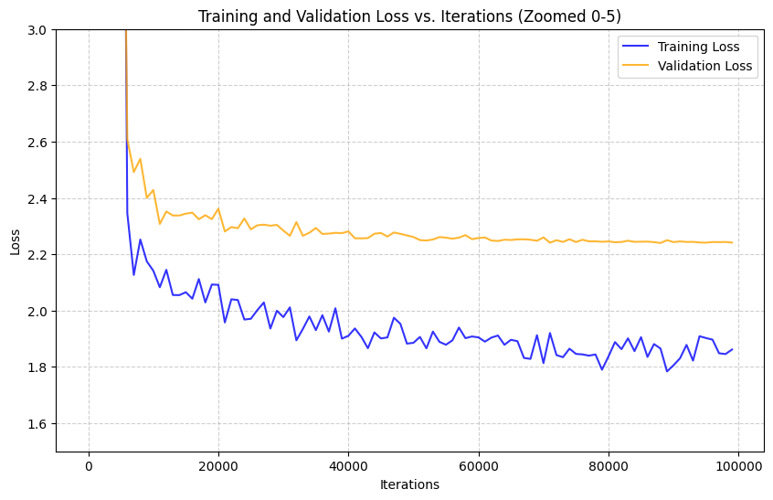
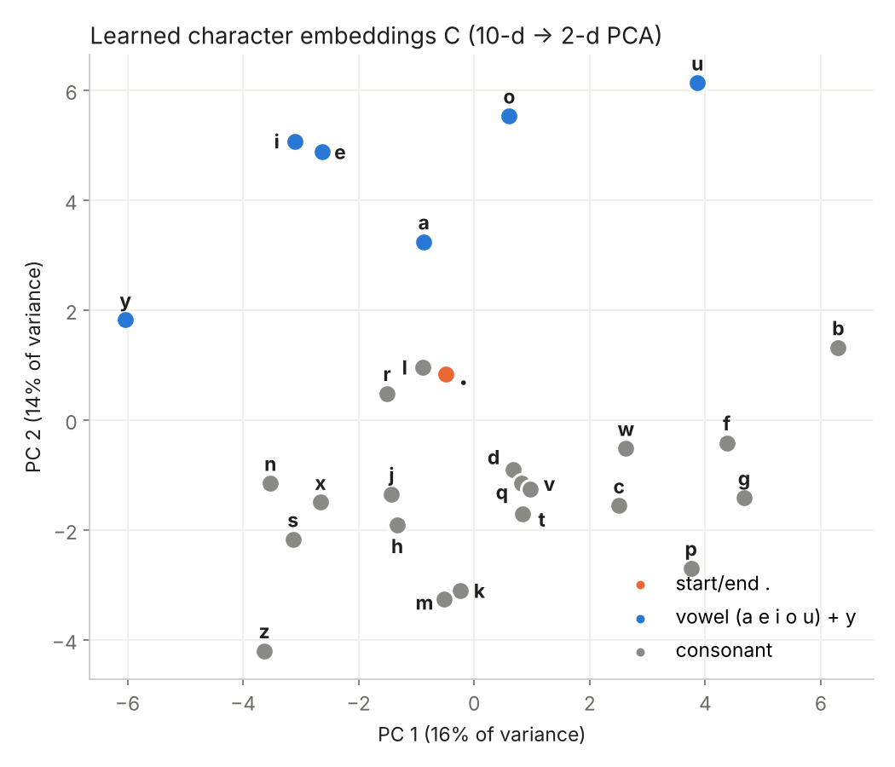
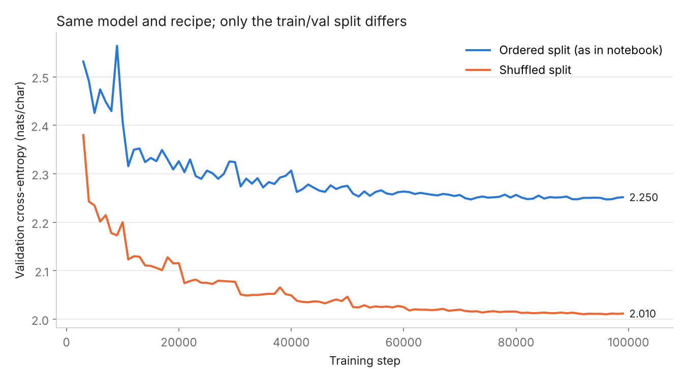

# A Neural Probabilistic Language Model, at the character level

A from-scratch PyTorch implementation of the MLP language model from
**Bengio, Ducharme, Vincent & Jauvin (2003), [*A Neural Probabilistic Language Model*](https://www.jmlr.org/papers/volume3/bengio03a/bengio03a.pdf)**,
trained on 32k names to generate new ones. It is the follow-up to
[`designing-bigram`](https://github.com/tusharchandra19/designing-bigram): the same task, but the
lookup table of counts is replaced with **learned embeddings + a hidden layer**, so the model can use
five characters of context instead of one.

The training recipe adds a few changes to the paper: **mini-batches, heavy-ball momentum with a
ramped β, step learning-rate decay**, and an L2 penalty on the hidden layer.

| Folder | Notebook | What it is |
|---|---|---|
| [`main/`](main/) | [`3_layer_nn_character_pred.ipynb`](main/3_layer_nn_character_pred.ipynb) | Final model: 5-char context, 10-d embeddings, 500 tanh units, momentum + step decay, 100k steps |
| [`rough/`](rough/) | [`makemore2.ipynb`](rough/makemore2.ipynb) | Scratch work: building the MLP step by step, a learning-rate sweep, a first 200k-step run |
| [`data/`](data/) | `names.txt` | 32,033 names (from [karpathy/makemore](https://github.com/karpathy/makemore)) |
| [`analysis/`](analysis/) | `rerun.py`, `make_figures.py` | seeded re-runs behind the † numbers and the figures below |
| [`assets/`](assets/) | figures | plots used in this README |

## Results

Cross-entropy in nats per character (lower is better; perplexity = e^loss).

| Model | Context | Val, split as in notebook | Val, shuffled split † |
|---|---|---|---|
| Uniform guess | 0 | 3.296 (ppl 27.0) | 3.296 |
| Bigram, smoothed counts ([previous repo](https://github.com/tusharchandra19/designing-bigram)) | 1 char | 2.591 (ppl 13.3) | 2.453 |
| **MLP, `main/`** | **5 chars** | **2.238 (ppl 9.4)**, original Colab run | **2.010 (ppl 7.5)** |

Within each column, every model is trained on the same 80% of names and scored on the same validation
names, so rows are directly comparable. † Seeded re-run of the exact same recipe with only `random.shuffle(words)`
added before splitting (the re-run on the original split gives 2.250, matching Colab's 2.238). See
[point 1 below](#things-worth-knowing-about-this-run).

Samples from the main model:

```
jester  shya  maileya  kaseen  kendalynn  sirwin  viyanna  elianna  aria
rhileigh  makenz  kayler  raelynn  lamon  ayleen
```



## From the paper to this code

### The model

The paper predicts word *wₜ* from the previous *n−1* words:

$$x = [\,C(w_{t-1}),\ \dots,\ C(w_{t-n+1})\,] \qquad y = b + Wx + U\tanh(d + Hx) \qquad \hat P(w_t \mid \text{context}) = \mathrm{softmax}(y)_{w_t}$$

This repo applies the same equation to characters:

```python
emb    = C[X]                       # [B, 5, 10]  look up 5 context characters
x      = emb.view(-1, 50)           # [B, 50]     concatenate  -> x
h      = (x @ W1 + b1).tanh()       # [B, 500]    tanh(d + Hx)
logits = h @ W2 + b2                # [B, 27]     b + U·h       (no direct W·x term)
loss   = F.cross_entropy(logits, Y) # mean −log softmax(y)[target]
```

| Paper | Here | Value |
|---|---|---|
| vocabulary \|V\| | `27` | a–z plus `.` (start/end) |
| context *n−1* | `block_size` | 5 (rough work tried 3 and 4) |
| feature matrix *C*, dim *m* | `C` | 27 × 10 |
| hidden weights *H*, bias *d* | `W1`, `b1` | 50 × 500, 500 |
| output weights *U*, bias *b* | `W2`, `b2` | 500 × 27, 27 |
| direct connections *W* | not used | — |
| total parameters | | 39,297 |

### Why it works

The paper's main argument is about the **curse of dimensionality**. An n-gram count table has |V|ⁿ
cells, and almost all of them are empty, so it can't generalise to contexts it hasn't seen. The MLP
instead maps each symbol to a dense vector in `C`, the same vector in every context position.
Gradients from every example update the vectors of the symbols that appear in it. Symbols that
behave alike end up near each other, so an unseen context like `..kay` borrows strength from similar
contexts like `..kai` or `..jay`.

Parameter count makes the point concretely. A 5-character count table would need 27⁵ × 27 ≈ 387M
cells. The MLP uses 39k parameters, and its cost grows **linearly** in context length (one more
`m`-wide slice of `W1` per extra character), not exponentially.



*First two principal components of the 10-d character embeddings `C` (seeded re-run of the main
recipe). The second component separates all five vowels from every consonant, and `y`, which acts
as both, sits between them. Nothing told the model what a vowel is; the grouping emerges because
vowels are interchangeable in many contexts (`m_ri`, `l_na`). This is the paper's "similar words get
similar feature vectors" argument, at the character level.*

### Training: what's different from the paper

| | Bengio et al. (2003) | This repo (`main/`) |
|---|---|---|
| Updates | SGD, one example at a time | mini-batches of 1,024 |
| Optimiser | plain SGD | **heavy-ball momentum** `v ← βv + g`, `θ ← θ − lr·v` |
| LR schedule | ε₀ / (1 + r·t) | **step decay**: halve every 10k steps (floor 2e-4) |
| Momentum schedule | — | β ramps 0.85 → 0.95 (+0.01 every 10k steps) |
| Regularisation | weight decay on *H*, *C*, *W* (1e-4 on Brown) | L2 `0.001·ΣW1²` on the hidden layer |
| Model selection | early stopping on validation | 100k steps; best-weights tracking written but commented out |
| Metric | perplexity | cross-entropy (perplexity = e^CE) |

**Why the β ramp?** With momentum, the effective step is about `lr / (1 − β)`. Raising β while
halving `lr` keeps some of the step size, so the optimiser keeps moving, while smoothing gradient
noise more and more as training settles:

| step | `lr` | β | effective step `lr/(1−β)` |
|---|---|---|---|
| 0 | 0.16 | 0.86 | 1.14 |
| 30k | 0.02 | 0.89 | 0.18 |
| 60k | 0.0025 | 0.92 | 0.031 |
| 90k | 0.0003 | 0.95 | 0.006 |

Mini-batches are a practical deviation. The paper's per-example SGD needed a cluster and weeks on
AP News. A batch of 1,024 gives a cheaper, less noisy gradient estimate and runs in minutes.

## Things worth knowing about this run

Found while writing this up. Each is documented next to the relevant cell, and the code is left as
it ran. Numbers marked † come from a seeded re-run of the exact same recipe
(`torch.manual_seed(42)`, [`analysis/rerun.py`](analysis/rerun.py)), since the Colab run wasn't seeded.

1. **The validation set is harder than the training set, because the split isn't shuffled.**
   `random.seed(42)` is set but `random.shuffle(words)` is missing. `names.txt` is roughly sorted by
   popularity, so the last 20% (val + test) is the long tail of rare names. Re-running the same
   recipe on a shuffled split†:

   | split | train | val | test | val − train |
   |---|---|---|---|---|
   | as in the notebook (ordered) | 1.835 | 2.250 | 2.292 | 0.415 |
   | shuffled | 1.888 | 2.010 | 2.007 | 0.122 |

   With a shuffled split the train/val gap shrinks from 0.42 to 0.12, and val drops by 0.24 nats.
   Most of the gap in the loss curve above comes from distribution shift, not overfitting.

   

2. **The W2 penalty is a no-op.** `0.001**(W2**2).sum()` uses `**` (power) instead of `*`. With
   ΣW2² in the thousands, 0.001 raised to that power underflows to exactly `0.0`, so it adds no loss
   and no gradient. Only `W1` is regularised.

3. **The printed training loss includes the L2 penalty.** At step 0 the 68.0 is ≈ 43 cross-entropy
   plus ≈ 25 from `0.001·ΣW1²`†. The penalty then shrinks `W1` until it adds only ≈ 0.07 at 20k
   steps†, so later values are close to pure cross-entropy.

4. **Unscaled initialisation.** Plain `randn` for `W1` makes pre-activations ~N(0, 50), and ~71% of
   `tanh` units start saturated (|tanh| > 0.99, gradient ≈ 0)†. Together with the large early
   effective step (≈ 1.1), this explains the spikes to 30–50 in the first ~5k steps. Scaling the init
   (e.g. `W1 * (5/3)/√50`, `b1 * 0.01`, `W2 * 0.01`, `b2 = 0`) starts the cross-entropy at 3.28 ≈ ln 27
   instead of ~43, with only ~10% of units saturated†.

5. **The test split is never evaluated.** The cell commented "loss on test set" evaluates `Xval`.

## Rough work highlights (`rough/`)

- Builds the model piece by piece: context windows → `C[X]` embedding lookup → three equivalent
  ways to flatten (`cat`, `unbind`, `view`) → hidden layer → manual softmax-NLL → `F.cross_entropy`.
- **Learning-rate sweep**: `lr` rises exponentially from 1e-3 to 1 over 1,000 steps. The loss is
  lowest around 0.1–0.2 and diverges beyond that.
- First full run: block 4, hidden 300, batch 64, 200k steps, `lr` halved every 25k. This split *is*
  shuffled.
- Evaluation bug: the "test" set is built from `words[:n2]` (train + val) instead of `words[n2:]`.
  Both evaluation cells also score the same last training mini-batch, which is why train and test
  print the identical 2.0233.

## Running locally

```bash
pip install -r requirements.txt
jupyter notebook
```

The main notebook reads `../data/names.txt`; the original Google Drive lines are kept in a comment.
The rough notebook downloads the dataset with `wget`. All outputs are from the original Colab runs.

## References

- Y. Bengio, R. Ducharme, P. Vincent, C. Jauvin. *A Neural Probabilistic Language Model.* JMLR 3 (2003) 1137–1155.
- A. Karpathy. [*makemore*](https://github.com/karpathy/makemore) and *Neural Networks: Zero to Hero* (part 2: MLP).
