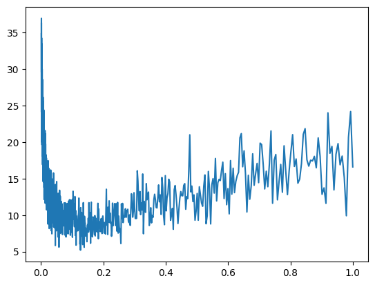

# Rough work: building the MLP step by step

**Notebook:** [`makemore2.ipynb`](makemore2.ipynb), a scratch notebook following Karpathy's
*makemore* part 2. The finished model is in [`../main`](../main).

## 1. Context windows
With `block_size = 3`, `emma` becomes `... → e`, `..e → m`, `.em → m`, `emm → a`, `mma → .`.
The first 5 names give 32 examples, and the full dataset gives 228,146.

## 2. The embedding table `C`
`C = randn(27, 2)`; `C[X]` with `X` of shape `[32, 3]` gives `[32, 3, 2]`. PyTorch fancy-indexes with
a whole integer tensor at once. This is the paper's shared feature matrix: a character has the same
vector whichever context slot it appears in.

## 3. Flattening the context, three ways
```python
torch.cat([emb[:, 0], emb[:, 1], emb[:, 2]], 1)   # explicit, hard-codes block_size
torch.cat(torch.unbind(emb, 1), 1)                # general, but allocates a new tensor
emb.view(32, 6)                                   # free: only changes stride metadata
```

## 4. Forward pass and loss by hand
`tanh(x @ W + b)` → `h @ W2 + b2` → `exp` / normalise → `-log p[target]`. With random weights the
loss is **18.5**, much worse than a uniform guess (ln 27 ≈ 3.3), because random logits are large and
confidently wrong. `F.cross_entropy` then replaces the manual three lines. It is fused and
numerically stable, since it subtracts the max logit before `exp`.

## 5. Learning-rate sweep
1,000 steps with `lr = 10^linspace(-3, 0)`, recording loss per step:



Loss falls until `lr` ≈ 0.1–0.2, then climbs as steps get too large. `lr` was set to the argmin.

- A log-scaled x-axis (`plt.semilogx`) spreads out the small-`lr` region, where most of the
  information is.
- The argmin of a noisy single-batch loss is jumpy. Smoothing the curve first gives a more stable
  pick.
- The samples right after the sweep (`koku`, `koku`, `koku`) are from the model the sweep wrecked
  at `lr = 1`. The sweep only picks `lr`; the real model is trained fresh afterwards.

## 6. First full run
Block 4, embedding 10, hidden 300 (`W1`: 40×300), batch 64, 200k steps, `lr` halved every 25k.
This split **is** shuffled (`random.shuffle(words)`).

Samples: `jerishel`, `zarshlie`, `ezelis`, `ulana`, `deera`.

**Evaluation bug.** `Xtest` is built from `words[:n2]` (train + val) instead of `words[n2:]`. Both
evaluation cells also reuse `ix`, the indices of the last training mini-batch. `Xtest` begins with
the same rows as `Xtr`, so the two cells evaluate the exact same 64 examples. That is why they both
print **2.0233**. Neither number is a held-out loss.

## What carried over to `main/`
- block size 4 → 5, hidden 300 → 500, batch 64 → 1,024;
- plain SGD → heavy-ball momentum with a β ramp, and halving every 10k steps instead of 25k;
- an L2 penalty on the hidden layer;
- validation loss tracked during training, and a train/val curve.
